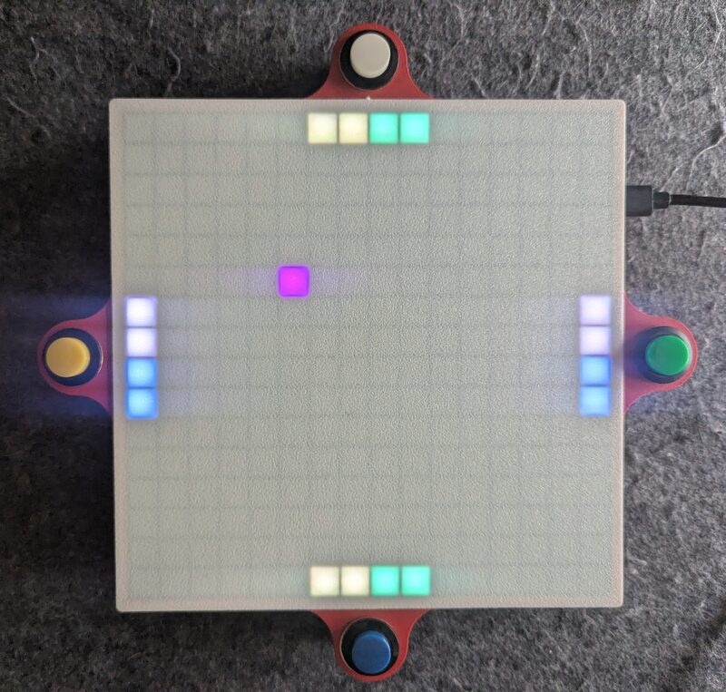
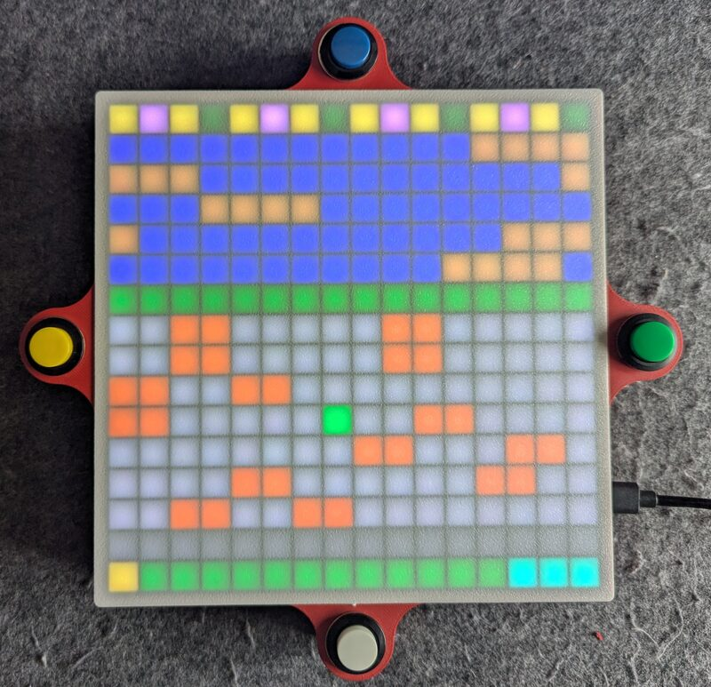
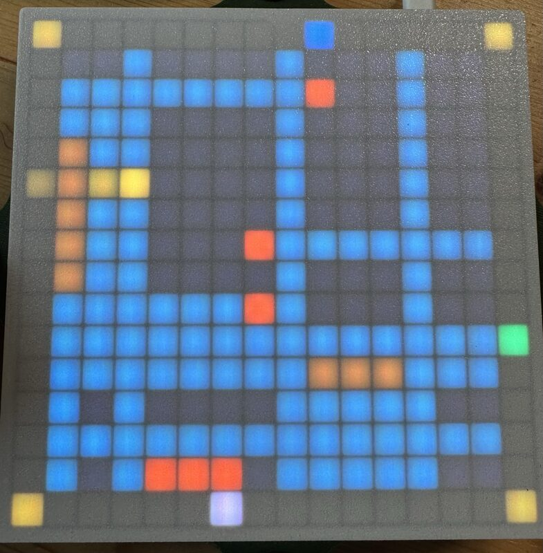
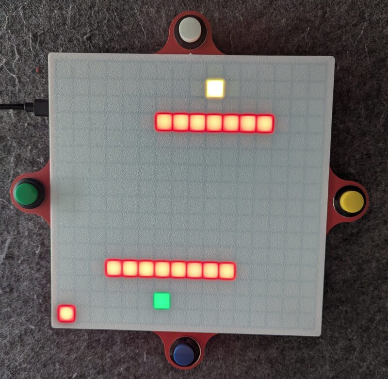
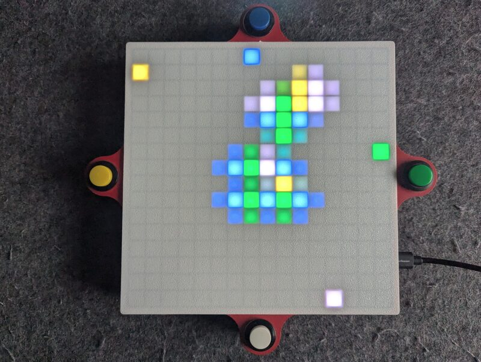
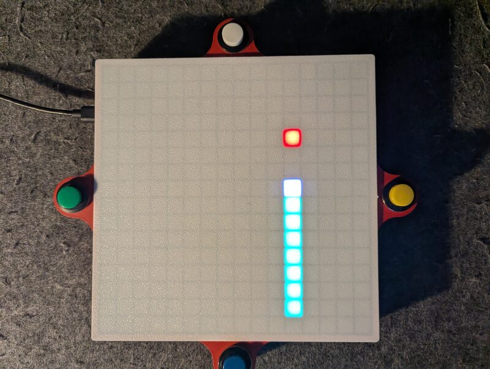
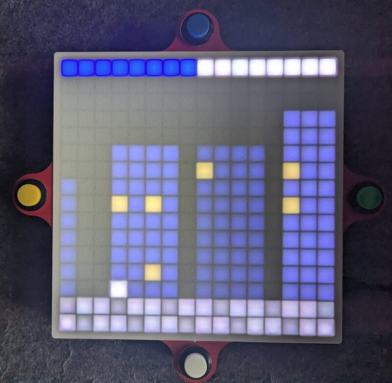

# openLUXbox – Spiele

Die openLUXbox enthält **acht Spiele**. Nach dem Start erscheint ein Auswahlmenü:
Mit **links/rechts** (gelb/grün) wird das Spiel gewählt, mit **unten** (weiß) gestartet.
Die Reihenfolge im Menü entspricht der Nummerierung unten.

> Allgemeine Informationen zum Projekt, zum Aufbau und zur Firmware findest Du im [README](README.md).

Alle Spiele liegen als Header-Dateien im Sketch-Verzeichnis `firmware/src/openLUXbox/`
und werden von `firmware/src/openLUXbox/openLUXbox.ino` eingebunden.

| Nr. | Spiel | Quelle |
|:---:|-------|--------|
| 1 | [4Pong](#1-4pong) | `firmware/src/openLUXbox/4Pong/4Pong.h` |
| 2 | [Frog](#2-frog) | `firmware/src/openLUXbox/Frog/frog.h` |
| 3 | [Kreuzfeuer](#3-kreuzfeuer) | `firmware/src/openLUXbox/Kreuzfeuer/kreuzfeuer.h` |
| 4 | [Lux](#4-lux) | `firmware/src/openLUXbox/Lux/lux.h` |
| 5 | [Nano Hexagon](#5-nano-hexagon) | `firmware/src/openLUXbox/Nano_Hexagon/nano_hexagon.h` |
| 6 | [Shining](#6-shining) | `firmware/src/openLUXbox/Shining/shining.h` |
| 7 | [Snake](#7-snake) | `firmware/src/openLUXbox/Snake/snake.h` |
| 8 | [CanoLbalt](#8-canolbalt) | `firmware/src/openLUXbox/CanoLbalt/canolbalt.h` |

---

## 1. 4Pong

Ein kooperativer Pong-Klon für 4 Spieler\*innen. Jeder Button bewegt zwei Schläger in die eigene Richtung.

---

## 2. Frog

Ein kooperativer Frogger-Klon. Steuert gemeinsam den Frosch zu den Fliegen am oberen Bildschirmrand. Bevor die Fliegen erscheinen, müsst Ihr aber 2 oder mehr Glühwürmchen aufsammeln, die an zufälliger Stelle erscheinen.

---

## 3. Kreuzfeuer

Autor: freaky-m0

Inspiriert durch „Schiffe versenken“. Die vier Spieler schießen mit einem Tastendruck auf die versteckten Schiffe. Bei einem Treffer werden diese sichtbar. Es gibt einen begrenzten, gemeinsamen Munitionsvorrat. Dieser wird durch die Farbe der vier Punkte in den Ecken dargestellt.

---

## 4. Lux

Das Spiel, das der openLUXbox seinen Namen gegeben hat.

Sammelt mit dem grünen Spielpunkt den gelben Punkt ein. Vermeidet rote Barrieren!

Mit jedem Button gebt Ihr dem Spielpunkt Schub von der eigenen Seite weg. So kann der Spielpunkt beschleunigt, gebremst und auch zum Stillstand gebracht werden. Ruht der Punkt, wird er dunkler. Ein Timer am Bildschirmrand begrenzt die Zeit pro Level.

17 Level mit steigendem Schwierigkeitsgrad, 3 Leben pro Spiel.

---

## 5. Nano Hexagon

Weicht den roten Balken aus! Ein kooperativer Klon von Hexagon.

---

## 6. Shining

In der Mitte erwacht ein pulsierender, leuchtender Kristallkern, der unaufhaltsam wächst. Haltet das wabernde Licht gemeinsam im Zaum, bevor es den Spielfeldrand berührt und die Matrix in einer gewaltigen Farbexplosion verglüht!

### Spielmechanismus

An jeder der vier Kanten patrouilliert automatisch ein Farb-Geschütz (Gelb, Grün, Blau, Weiß). Ein Knopfdruck feuert einen Geschoss der eigenen Farbe geradeaus ins Zentrum. (Erst nach Treffer oder Verlassen des Feldes ist der nächste Schuss bereit).

Schüsse zerstören nur Kern-Pixel der gleichen Farbe. Andere Farben werden durchdrungen. Geht ein Schuss bis zur anderen Seite durch und trifft das gegenüberliegende Geschütz, friert dieses für 1 Sekunde ein.

Das Spiel endet sofort, sobald das Kristallgitter eine der vier Außenkanten berührt.

### Punkte & Highscore

+1 Punkt pro zerstörtem Farb-Pixel.

+50 Extrapunkte: Wenn der gesamte Kristallkern restlos abgeräumt wird (Screen flashed, neuer Kern startet bei höherem Spieltempo).

---

## 7. Snake

Ein simpler Snake-Klon. Dieses Spiel ist auf dem Workshop der Retrolution live per Vide-Coding entstanden.

---

## 8. CanoLbalt

Rennt über die Dächer der Stadt um Euer Leben, springt über Schluchten, Hindernisse und über herabstürzende Trümmerteile. Wie lange haltet Ihr durch?

Nach dem Vorbild von Canabalt müssen die 4 Spieler\*innen die Spielfigur rechtzeitig springen lassen.

**Ziel:** Als Team möglichst weit über die Dächer rennen, ohne abzustürzen oder von Trümmern getroffen zu werden.

**Wer springt?** Vor jedem Sprung leuchten am Rand die LED-Farben der zwei Spieler\*innen, die als nächstes an der Reihe sind.

**Was tun?** Nur die beiden aufgerufenen Spieler\*innen müssen gleichzeitig ihren Button drücken, damit die Figur springt.

**Tipp:** Taster gedrückt halten, um weiter zu springen. Nach jedem Sprung wechselt das Duo!
